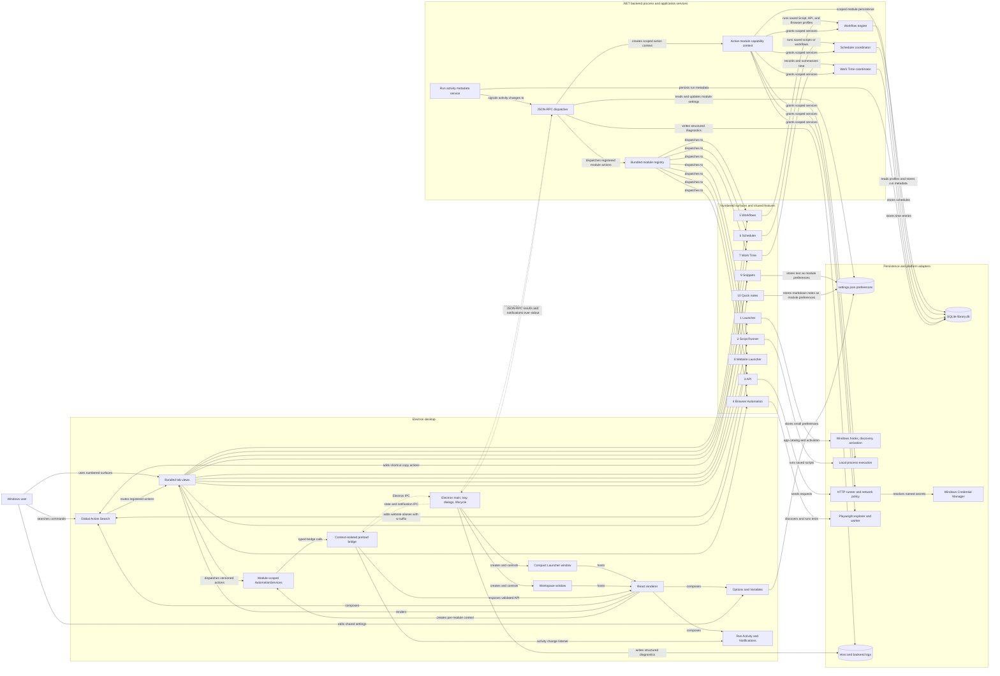

# Automator multi-layer graph

Source of truth: `docs/architecture/automator-multilayer-graph.md`. Generated by `scripts/build-okf.mjs`.

This document links a semantic view of the application to a concrete method-level execution trace. The first graph summarizes the current product and runtime relationships. The second follows one Browser Automation test run through the renderer, Electron, the .NET backend, and process infrastructure.

The method graph is a verified representative path, not an exhaustive call graph of every method in the repository. Message edges across IPC and process boundaries are labeled separately from ordinary calls. Lines and callbacks are not treated as direct calls across those boundaries.

### Application and runtime layer

The tab nodes represent the user-facing view and, where applicable, its matching compiled-in backend module. Slot 1 keeps legacy command routes, so it does not use the module-action dispatch path shown below. Slot 9 is Snippets: it registers no module actions, so it does not use the dispatch path and keeps its text in module preferences, and the clipboard write happens in the renderer. Its snippets that have a shortcut are also published in the module state so Global Action Search can copy one and close the launcher without opening the tab. The Codex task builder code is retained but is not bound to a slot. Work Time is the product label even though its backend module still uses the `FocusSessionsModule` name. The old WinUI application and retained focus-cycle coordinator are compatibility code and are omitted from the active runtime graph.

### Method-level layer: Browser Automation `runTests`

This trace starts when the Browser Automation view receives a run request. It includes the main call path and the result path back to the view. `calls`, `interface dispatch`, and `callback` labels describe in-process execution. Dashed arrows are IPC, JSON-RPC, or stream events across a boundary.

```mermaid
flowchart LR
  browserFeature["Browser Automation · slot 4"]

  subgraph rendererMethods["React renderer"]
    run["BrowserAutomationView.run"]
    dispatch["createAutomationServices · modules.dispatch"]
    show["BrowserAutomationView.showResult"]
    readOutput["BrowserAutomationView.readRunOutput"]
    browserFeature -->|implements view| run
    run -->|calls action facade| dispatch
    run -->|shows returned result| show
    run -->|parses returned output| readOutput
  end

  subgraph preloadMethods["Electron preload"]
    bridge["api.dispatchModuleAction"]
  end

  subgraph mainMethods["Electron main and backend client"]
    handler["automator:module-action IPC handler"]
    invoke["invokeModuleBackend"]
    assertFrame["assertMainFrame"]
    request["BackendProcess.request"]
    consume["BackendProcess.consumeStdout"]
    handler -->|calls| invoke
    invoke -->|validates caller| assertFrame
    invoke -->|sends request| request
  end

  subgraph backendMethods[".NET backend"]
    readLine["BackendServer.RunAsync"]
    handleLine["BackendServer.HandleLineAsync"]
    handleCore["BackendServer.HandleLineCoreAsync"]
    route["BackendServer.DispatchAsync"]
    executeAction["BackendServer.ExecuteModuleActionAsync"]
    requestExecutor["AutomationRequestExecutor.ExecuteAsync"]
    callback["module action callback"]
    writeResult["BackendServer.WriteProtocolAsync"]
    readLine -->|calls| handleLine
    handleLine -->|moduleAction path| handleCore
    handleCore -->|calls| route
    route -->|routes moduleAction| executeAction
    executeAction -->|calls| requestExecutor
    requestExecutor -->|invokes supplied callback| callback
    handleCore -->|writes response after await| writeResult
  end

  subgraph moduleMethods["Application module execution"]
    registry["AutomationModuleRegistry.DispatchAsync"]
    module["BrowserAutomationModule.ExecuteAsync"]
    createExplorer["BrowserAutomationModule.CreateExplorer"]
    explorer["PlaywrightTestExplorer.RunAsync"]
    discover["PlaywrightTestExplorer.DiscoverTestsAsync"]
    processContext["ContextProcessService.ExecuteAsync"]
    registry -->|interface dispatch| module
    module -->|runTests action| createExplorer
    createExplorer -->|creates explorer and returns| explorer
    explorer -->|refreshes test list| discover
    explorer -->|runs selected tests| processContext
    discover -->|lists tests using Playwright| processContext
  end

  subgraph processMethods["Process infrastructure"]
    localProcess["LocalProcessExecutionService.ExecuteAsync"]
    drain["LocalProcessExecutionService.ReadBoundedAsync"]
    localProcess -->|captures stdout and stderr| drain
  end

  dispatch -->|calls exposed bridge method| bridge
  bridge -.->|IPC invoke| handler
  request -.->|stdin JSON-RPC request| readLine
  callback -->|calls| registry
  processContext -->|interface dispatch| localProcess
  writeResult -.->|stdout response event| consume
  consume -->|resolves pending request promise| request
  request -->|returns result promise| invoke
  invoke -->|returns result| handler
  handler -.->|IPC result| bridge
  bridge -->|resolves action request| dispatch
  dispatch -->|resolves result| run
```

#### Cross-layer links and evidence

| Application concept | Code anchor | Relationship |
|---|---|---|
| Browser Automation tab | [`BrowserAutomationView.tsx`](../../ui/modules/BrowserAutomationView.tsx#L224) | The view's `run` function dispatches the `runTests` action. |
| Module-scoped action service | [`automationServices.ts`](../../ui/automationServices.ts#L180) | Validates the declared action, creates a request ID, and calls the bridge. |
| Preload and Electron boundary | [`preload.ts`](../../electron/preload.ts#L114), [`main.ts`](../../electron/main.ts#L570) | Preload validates the request and invokes IPC; Electron main forwards it to the backend. |
| Host/backend transport | [`backendProcess.ts`](../../electron/backendProcess.ts#L74), [`BackendServer.cs`](../../src/Automator.Backend/BackendServer.cs#L88) | Writes a JSON-RPC line to child stdin; the backend reads and routes it. |
| Backend request path | [`BackendServer.cs`](../../src/Automator.Backend/BackendServer.cs#L151) | Parses and routes the JSON-RPC request, then writes its response. |
| Module authorization and dispatch | [`AutomationModuleRegistry.cs`](../../src/Automator.Application/Automation/AutomationModuleRegistry.cs#L74) | Checks the active module, action versions, and required capabilities before calling the module. |
| Request lifetime and callback | [`AutomationRequestExecutor.cs`](../../src/Automator.Application/Automation/AutomationRequestExecutor.cs#L29), [`BackendServer.cs`](../../src/Automator.Backend/BackendServer.cs#L416) | Tracks the request lifetime and invokes the callback that dispatches the module action. |
| Browser test execution | [`BrowserAutomationModule.cs`](../../src/Automator.Application/Automation/BrowserAutomationModule.cs#L79), [`PlaywrightTestExplorer.cs`](../../src/Automator.Application/Automation/PlaywrightTestExplorer.cs#L177) | The `runTests` action creates the explorer, which discovers tests and runs the selected test set. |
| Host-granted process capability | [`AutomationServicesContext.cs`](../../src/Automator.Application/Automation/AutomationServicesContext.cs#L206), [`LocalProcessExecutionService.cs`](../../src/Automator.Infrastructure/Automation/LocalProcessExecutionService.cs#L11) | The scoped context wraps the concrete process service; the service owns process execution and bounded output capture. |
| Result path back to the renderer | [`BackendServer.cs`](../../src/Automator.Backend/BackendServer.cs#L158), [`backendProcess.ts`](../../electron/backendProcess.ts#L170), [`BrowserAutomationView.tsx`](../../ui/modules/BrowserAutomationView.tsx#L235) | The backend writes the result, the host resolves the pending request, and the view handles it. |

The graph omits schema validation details, cancellation branches, activity persistence internals, project-root checks, and Playwright's third-party runner internals. These remain in the linked source and the [Browser Automation guide](../tabs/browser-automation/README.md).

### Layer conventions

- **Application layer:** product surfaces, user-visible features, and their conceptual interactions.
- **Runtime layer:** renderer, preload, Electron main, JSON-RPC backend, module registry, and host-granted services.
- **Code layer:** concrete functions and methods for a representative execution path.
- **Edge labels:** `uses`, `runs`, and `stores` describe application relationships; `calls`, `interface dispatch`, `IPC`, `JSON-RPC`, and `callback` describe the implementation path.

The Browser Automation method trace is also a cross-layer drilldown: the `Browser Automation · slot 4` node maps to the view entry point, then follows the same action through its runtime owners to the process adapter.
